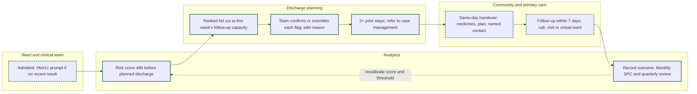

# Business Analysis Pack: Discharge Follow-Up Redesign

This pack turns the readmissions analysis into a proposed service change for the fictional Meridian Health Network. It covers the current process, the gaps the data exposes, the target process and prioritised requirements, each traced to evidence in the [full case study](Readmissions-Case-Study.pdf).

> **Scope note.** Meridian and its stakeholder exercise are fictional. The as-is process is an assumed baseline built from the discovery questions in section 2 of the case study ("How is readmission risk identified today?", "Which patients receive follow-up after discharge today?", "What limits the number of patients your team can follow up?"). In a real engagement it would be validated in a walkthrough with discharge planners before use. The evidence figures come from the analysis of historical public data.

## 1. Stakeholders

| Stakeholder | Interest | Decision they own |
| --- | --- | --- |
| Director of Clinical Operations | Bed pressure and readmission penalties | Where resources go; handover standards |
| Discharge planning leads | Limited follow-up capacity | Who receives follow-up each week |
| Diabetes clinical lead | Quality of diabetes care | Clinical sign-off of the risk score; HbA1c practice |
| Finance director | Cost of any new service | Whether targeted follow-up is funded |
| Analytics team | Model quality and fairness | Validation, monitoring and recalibration |
| Information governance lead and clinical safety officer | Lawful, safe use of patient data | Go-live approval |

## 2. Current process (as-is, assumed)

```mermaid
flowchart LR
  subgraph W[Ward and clinical team]
    A[Patient admitted and treated] --> B[HbA1c tested if a clinician orders it]:::gap
    B --> C[Consultant decides on discharge]
  end
  subgraph D[Discharge planning]
    E[Arrange destination: home, rehab or nursing] --> F[Follow-up offered by judgement or on request]:::gap
  end
  subgraph CP[Community and primary care]
    G[Discharge summary reaches GP or facility later]:::gap --> H[Patient worsens, returns through A&E]
  end
  subgraph AN[Analytics]
    I[Readmission totals reported each quarter]:::gap
  end
  C --> E
  F --> G
  H -.-> I
  classDef gap stroke:#ED553B,stroke-width:2px
```

Steps outlined in red carry one or more of the gaps in section 3.

## 3. Gap analysis

| # | Area | Current state | Target state | Evidence from the data | Requirements |
| --- | --- | --- | --- | --- | --- |
| 1 | Risk identification | Follow-up chosen by clinician judgement or on request | Ranked risk list 48 hours before planned discharge | Highest-risk 10% readmit at 20.1%; lowest 10% at 3.9% | R1, R2, R4 |
| 2 | Capacity matching | No link between team capacity and who is chosen | List cut at the team's weekly follow-up capacity | At 20% capacity the score captures 37.1% of readmissions, against about 20% for unranked selection | R3, R12 |
| 3 | Handover to rehab and nursing facilities | Discharge summary, which can arrive days later | Same-day structured handover with a named contact | Odds ratio 2.96 for rehab or other inpatient care; 1.75 for nursing facilities | R6 |
| 4 | Frequent attenders | No referral rule | Case-management referral from 2 prior stays | Readmission 18.5% at 2 prior stays; 29.3% at 4 or more | R7 |
| 5 | HbA1c monitoring | Tested when a clinician orders it | Prompt when no recent result exists | 18.4% of patients tested; about 10% for elective and musculoskeletal admissions | R10 |
| 6 | Measurement and fairness | Quarterly totals, with no link to who received follow-up | Outcome recorded per patient; monthly SPC; quarterly model and fairness check | Recall 32% for African American patients against 38% for Caucasian patients at the same 9.1% readmission rate | R8, R9, R11 |

## 4. Target process (to-be)

Solid green outline: new step. Dashed green outline: existing step done differently.

## 5. Requirements (MoSCoW)

| ID | Requirement | Acceptance criterion | Priority | Owner |
| --- | --- | --- | --- | --- |
| R1 | Produce a ranked readmission risk list for adult diabetic inpatients 48 hours before planned discharge | List available for at least 95% of eligible discharges in a 4-week pilot | Must | Analytics team |
| R2 | Validate the score on current local data before go-live | Validation report covering AUC, calibration and subgroup results, signed off by the diabetes clinical lead | Must | Analytics team |
| R3 | Set the flag threshold from the team's weekly follow-up capacity | Patients flagged each week within 5% of stated capacity | Must | Discharge planning leads |
| R4 | Let a clinician confirm or override each flag and record the reason | Every flag has a recorded decision; overrides reviewed monthly | Must | Discharge planning leads |
| R5 | Complete information governance and clinical safety checks before live use | DPIA decision, lawful basis, role-based access and DCB0129/DCB0160 assessment recorded | Must | IG lead, clinical safety officer |
| R6 | Send a structured handover on discharge day for patients going to rehab or nursing facilities | Medicines list, care plan and named contact present in at least 90% of these discharges, audited monthly | Should | Director of Clinical Operations |
| R7 | Prompt a case-management referral for patients with 2 or more inpatient stays in the past year | Prompt shown for every eligible patient, with the referral decision recorded | Should | Diabetes clinical lead |
| R8 | Check model performance by race, sex and age every quarter | Recall, precision and false positive rate reported by group; a gap above 5 points triggers a review | Should | Analytics team |
| R9 | Record follow-up and the 30-day outcome for every flagged patient | Outcome recorded for at least 95% of flagged patients | Should | Discharge planning leads |
| R10 | Prompt an HbA1c test at admission when no recent result exists | Testing rate tracked monthly against the 18.4% baseline | Could | Diabetes clinical lead |
| R11 | Track 30-day readmission monthly on an SPC chart in Power BI | Chart refreshed monthly from dated extracts | Could | Analytics team |
| R12 | Give managers a capacity explorer to compare workload and capture | Shows flagged patients, recall and precision from 10% to 50% capacity (prototyped on the portfolio page) | Could | Analytics team |
| R13 | Automate follow-up decisions without clinician review | Out of scope: an AUC of 0.65 supports ranking, not individual decisions | Won't (this phase) | — |
| R14 | Add social care and deprivation data | Next phase: needs a data-sharing agreement | Won't (this phase) | — |
| R15 | Integrate the score into the electronic record in real time | The pilot uses a daily extract | Won't (this phase) | — |

**Prioritisation logic.** Must-haves are the minimum for a safe, governed pilot: without R1 to R5 nothing can go live. Should-haves act on the strongest remaining evidence (handover and frequent attenders) and make the pilot measurable (R8, R9). Could-haves improve monitoring and care quality but do not block the pilot. HbA1c sits in Could because its link to readmission is negligible (Cramér's V 0.010): it is a care quality review, not a readmission fix.

## 6. Traceability

| Requirement | Gap | Stakeholder need | Case study section | Pilot measure |
| --- | --- | --- | --- | --- |
| R1, R2 | 1 | Discharge planning: who receives follow-up? | 8 (model, capacity) | Share of readmissions in flagged group |
| R3, R12 | 2 | Discharge planning: capacity is limited | 8.1 | Weekly flags against capacity |
| R4 | 1 | Diabetes clinical lead: clinician judgement retained | 10 (governance) | Flags with a recorded decision |
| R5 | — | IG and clinical safety | 10 (governance) | Go-live approval |
| R6 | 3 | Director of Clinical Operations: where should resources go? | 9 (recommendation 2) | Handover compliance |
| R7 | 4 | Diabetes clinical lead: frequent attenders | 9 (recommendation 3) | Referral decisions recorded |
| R8 | 6 | Analytics: fairness before rollout | 8.3, 8.4 | Recall gap between groups |
| R9, R11 | 6 | Finance: is follow-up worth funding? | 9 (business case) | 30-day readmission vs comparison group |
| R10 | 5 | Diabetes clinical lead: should care processes change? | 7 (HbA1c) | Testing rate against 18.4% baseline |

## 7. How the pilot would be judged

- 30-day readmission among followed-up patients, compared with a matched group not followed up
- Share of readmissions in the flagged group, tracked against the 37.1% expected at 20% capacity
- Process measures: flags with a recorded decision (R4), handover compliance (R6), outcome recording (R9)
- Fairness: the recall gap between groups closing below 5 points (R8)
- Finance: cost per prevented readmission against the break-even prevention rate in section 9 of the case study

## 8. Open questions for a real discovery

1. Does the as-is map match how discharge planners actually work today? Walk it through with them.
2. What is the team's real weekly follow-up capacity, and does it vary by season?
3. Who receives the discharge summary for patients going to rehab or nursing facilities, and how long does it take to arrive?
4. Is there an existing case-management service with spare capacity?
5. Which data feed could deliver the risk score 48 hours before discharge, and who owns it?
